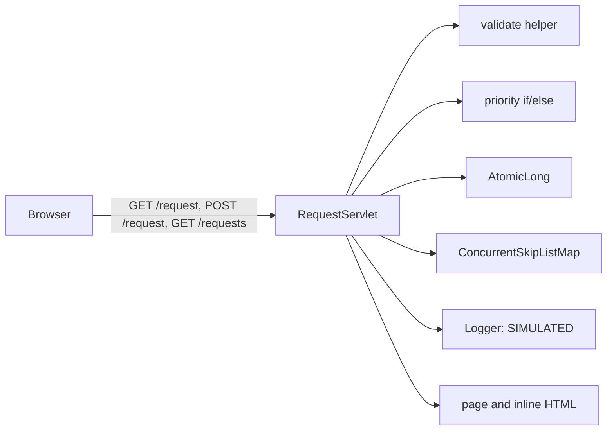
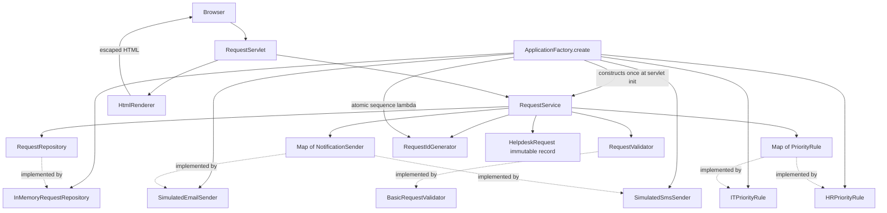

# Architecture before and after

## Version 1: safe behaviour, mixed reasons to change

These helper boxes are methods/fields inside the same class, not independently injected collaborators. `Entry` is a nested immutable record. Any notification, validation or rendering edit brings the developer into the servlet.

## Version 2: composition and request flow

The arrows from service to contracts describe compile-time dependencies. Factory arrows describe concrete construction. No runtime service locator is used. The servlet stores a shared service initialized safely by the container before handling requests; request input is never stored in servlet fields.

`submit` validates first, computes priority and ID, saves, then simulates notification. It returns an immutable model to the servlet for rendering. `list` returns an immutable repository snapshot. The factory registers rules and senders using immutable maps; adding a registration does not alter rule lookup. Test-only Finance and BadSender are absent from this runtime diagram and WAR.
